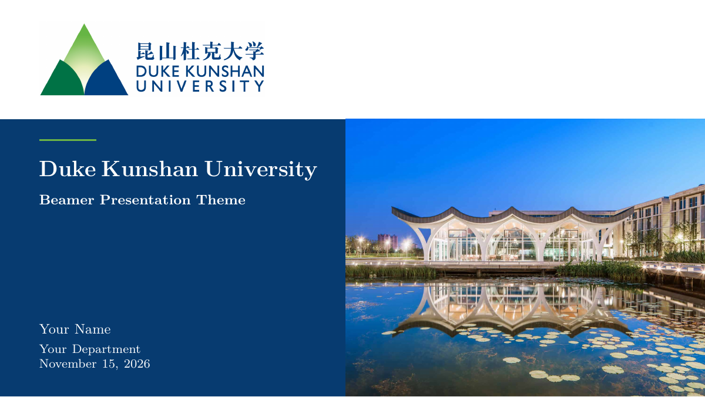
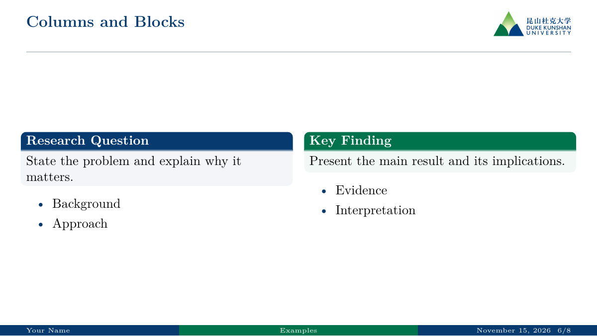

# DKUbeamer

A clean, unofficial LaTeX Beamer presentation theme for **Duke Kunshan University**.

昆山杜克大学风格的非官方 Beamer 模板：校园照片封面、白底标题与细分隔线、蓝绿分段页脚，适用于学术报告和课程展示。




[查看完整 PDF](DKU-Beamer.pdf) · [素材来源与许可说明](source/dku/README.md)

## 快速开始

使用 TeX Live 或 MiKTeX，安装 XeLaTeX、Beamer、TikZ 和 listings。在项目根目录运行：

```sh
latexmk -xelatex -interaction=nonstopmode -halt-on-error -outdir=build main.tex
```

生成文件位于 `build/main.pdf`。没有 latexmk 时，可以连续运行两次：

```sh
xelatex -interaction=nonstopmode -halt-on-error -output-directory=build main.tex
```

使用该命令前先创建 `build` 目录。两次编译用于更新目录和页码。

**Overleaf：** 下载仓库 ZIP 并上传，选择 `main.tex` 为主文档，编译器选择 **XeLaTeX**。

## 修改内容

编辑 `main.tex` 中的标题、作者、单位和日期。可选的短写用于底部信息栏：

```tex
\title{Your Presentation Title}
\subtitle{Your Subtitle}
\author[Short Name]{Full Author Name}
\institute[DKU]{Your Department}
\date[Nov. 2026]{November 15, 2026}
```

- 默认比例为 16:9。
- 每个章节自动插入目录页；长章节名可用 `\section[Short Name]{Full Section Name}`。
- 底栏依次显示作者、章节、日期与页码。
- 封面和结束页不计入页码。
- 使用 `\backmatter[Questions?]` 修改结束页文字。
- 长封面标题可用 `\setbeamerfont{title}{size=\large}` 缩小字号。

**中文正文：** 取消 `main.tex` 中 `\usepackage[UTF8,fontset=fandol]{ctex}` 的注释，并使用 XeLaTeX。需要安装 ctex 和 Fandol 字体。

主题样式集中在 `dku.sty`。封面照片与目录背景可在加载主题后覆盖：

```tex
\renewcommand{\dkucover}{source/dku/ab-1.jpg}
\renewcommand{\dkusectionbackground}{source/dku/pavilion-2.jpg}
```

## 文件结构

```text
main.tex          示例演示文稿
dku.sty          主题样式
DKU-Beamer.pdf    编译后的示例预览
docs/             README 预览图片
source/dku/       模板使用的图片与来源记录
LICENSE           代码的 MIT 许可证
```

## 来源与许可

主题由西湖大学风格模板改编，代码源自 [Rui Song 的 PolyU-Beamer-Slides](https://github.com/wurahara/PolyU-Beamer-Slides)。保留原作者的版权声明，主题代码和示例 LaTeX 使用 [MIT License](LICENSE)。

**MIT 许可不涵盖校徽、校名、校园照片，以及包含这些素材的预览文件。** 素材的开放再分发许可尚未核实；详细来源见 [Asset sources](source/dku/README.md)。本项目不代表昆山杜克大学，也未宣称获得校方认可。蓝绿配色为模板设计选择，并非官方品牌规范。
